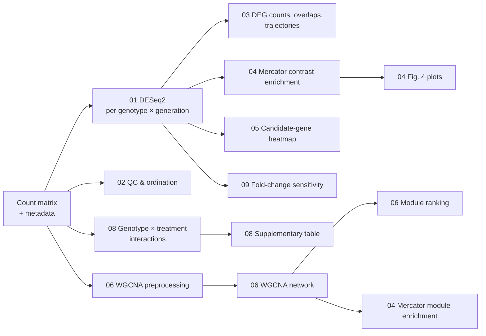

# GSNOR multigenerational climate-stress transcriptomics — analysis code

[](https://doi.org/10.1093/jxb/erag557)
[](https://doi.org/10.64898/2026.08.05.742973)
[](https://www.ebi.ac.uk/biostudies/arrayexpress/studies/E-MTAB-17127)


R analysis code for:

> Behl R, Ghirardo A, Winkler JB, Jafarian S, Frungillo L, Spoel SH, Fischback A, Huber G, Koller R, Albert A, Mattes E, Gößl L, Mayer KFX, Johannes F, Lindermayr C, Schnitzler JP.
> **GSNOR-dependent nitric oxide homeostasis promotes recovery from repeated climate stress across generations in *Arabidopsis thaliana*.**
> *Journal of Experimental Botany* (2026). https://doi.org/10.1093/jxb/erag557

Preprint: *bioRxiv* (2026), https://doi.org/10.64898/2026.08.05.742973

The scripts analyse RNA-seq from wild-type (WT) and *gsnor* knockout Arabidopsis
grown over five generations under repeated climate-stress treatments, sampled at
generations G1, G3 and G5. They cover differential expression (DESeq2), QC and
ordination (PCA, DAPC, clustering), DEG overlap and gene-state trajectories,
Mercator functional enrichment, WGCNA co-expression networks, genotype × treatment
interaction models, fold-change sensitivity analyses, and the *Pseudomonas* CFU assay.

## Data availability

| Data | Where |
|---|---|
| Raw RNA-seq reads | ArrayExpress [E-MTAB-17127](https://www.ebi.ac.uk/biostudies/arrayexpress/studies/E-MTAB-17127) |
| Gene-count matrix, sample metadata, phenotype tables, supplementary files, FastQC reports | Zenodo [10.5281/zenodo.20343453](https://doi.org/10.5281/zenodo.20343453) |

Input data are **not** included in this repository.

## Repository layout

| Folder | What it does | Manuscript items |
|---|---|---|
| [`01_differential_expression/`](01_differential_expression) | DESeq2 per genotype × generation (WT/*gsnor* × G1/G3/G5); full results and up/down gene lists | input to all downstream steps |
| [`02_quality_control_and_ordination/`](02_quality_control_and_ordination) | Normalised library distributions, dendrograms, PCA, DAPC, clock genes | Fig. 3; S4A, S5, S6, S7 |
| [`03_deg_counts_overlap_and_trajectories/`](03_deg_counts_overlap_and_trajectories) | DEG counts, Venn/UpSet, overlap statistics, volcano plots, alluvial states, trajectory heatmaps, transcription factors | Fig. 3B–C; S15, S16, S18–S23 |
| [`04_functional_enrichment/`](04_functional_enrichment) | Contrast-specific Mercator enrichment and plotting; WGCNA-module enrichment | Fig. 4; S17 |
| [`05_candidate_genes/`](05_candidate_genes) | Candidate-gene expression heatmap | Fig. 6 |
| [`06_wgcna/`](06_wgcna) | WGCNA preprocessing, network construction, module ranking | — |
| [`07_pathogen_assay/`](07_pathogen_assay) | *P. syringae* CFU analysis | S30 |
| [`08_genotype_treatment_interactions/`](08_genotype_treatment_interactions) | DESeq2 genotype × treatment interaction tests per generation | S25 |
| [`09_fold_change_sensitivity/`](09_fold_change_sensitivity) | DEG counts and trajectory rules at \|LFC\| cutoffs 0, 0.2, 0.5 | S26, S28 |
| [`10_optional_templates/`](10_optional_templates) | Optional pedigree-sensitivity template (not a reported analysis) | — |

Figure/supplement labels come from the script names; check them against the final
published numbering.

## Workflow



## Getting started

**Requirements:** R (≥ 4.3 recommended; DESeq2 v1.42.1 was used in the paper) and the
CRAN/Bioconductor packages listed in [`install_packages.R`](install_packages.R):

```r
source("install_packages.R")
```

**Running the scripts.** Each script is standalone and is run interactively (e.g. in RStudio):

1. Download the count matrix and metadata (see *Data availability*).
2. Edit the input/output paths at the top of each script. They currently point to the
   original analysis machine (`~/Documents/DNA_seq/RNA_seq/...`).
3. Run folder `01` first; most later scripts read its DESeq2 outputs.

Points to watch:

- The count table is called `Count_matrix.txt` in some scripts and
  `genes_gtf_merged_gene_counts.txt` in others. Point both at the deposited count matrix.
- Scripts in `08` and `09` expect `Metadata_Sample_Area_medians_WITH_GROUPS.csv` with
  columns `SampleName`, `Genotype`, `Treatment`, `Generation`.
- `03/Venn Fig3C.R` must run before `03/Fig3C_overlap_statistics.R`, in the same R session.
- `04/Mercator_enrichment_S17_contrast_background.R` runs before `04/Go term_logic revived_Fig 4.R`.
  `04/Mercator Go analysis.R` needs the module assignments from `06`.
- `06/Preprocessing WGCNA.R` writes `vsd_batch.csv`, but `06/WGCNA_final_ME40,0.4.R` reads
  `vsd.csv`. Confirm which VST input you want.
- At G5, treatment labels mean *treatment history*: G4 and G5 plants were grown under control conditions.

The full notes from the deposited archive are in
[`docs/zenodo_archive_README.md`](docs/zenodo_archive_README.md).

## Relationship to the Zenodo archive

The R scripts here are byte-identical to the deposited code archive (version of
9 October 2026; see [`CHANGES.md`](CHANGES.md)). To check them:

```bash
tail -n +2 SHA256SUMS.csv | python3 -c "import csv,sys;[print(f'{h}  {f}') for f,h in csv.reader(sys.stdin)]" | sha256sum -c
```

All scripts should report `OK`. The `README.md` line will report `FAILED`, which is expected:
the archive's original README now lives at
[`docs/zenodo_archive_README.md`](docs/zenodo_archive_README.md) (unchanged), and this
GitHub README has taken its place.

## Scope

The analyses were not rerun when this repository was created. Not included: the main
phenotyping statistics (GLMs on rosette area, chlorophyll fluorescence, seed traits) and
the remeasurement analysis behind Supplementary File S27. Upstream processing (HISAT2
v2.2.1 alignment to TAIR10, featureCounts) is described in the paper's Methods.

## Citation

If you use this code, please cite the *Journal of Experimental Botany* article above. Citation metadata is in
[`CITATION.cff`](CITATION.cff); GitHub shows it under **Cite this repository**.

## License

Released under the [MIT License](LICENSE).
